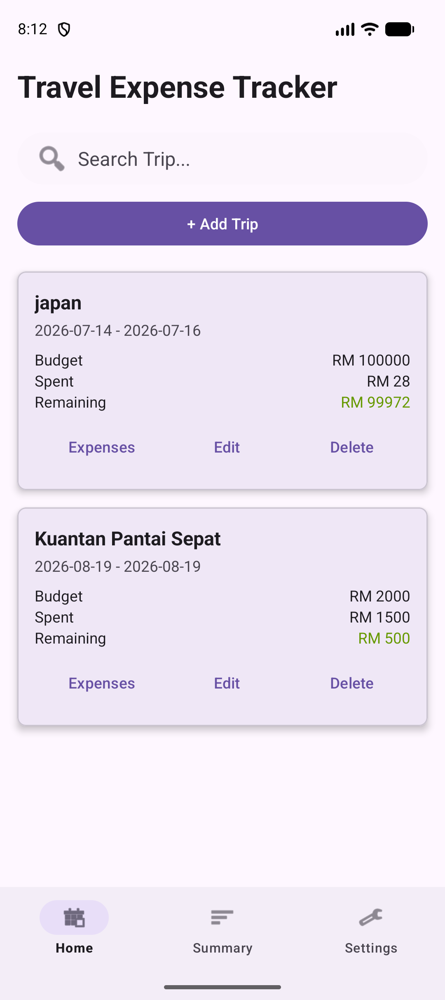
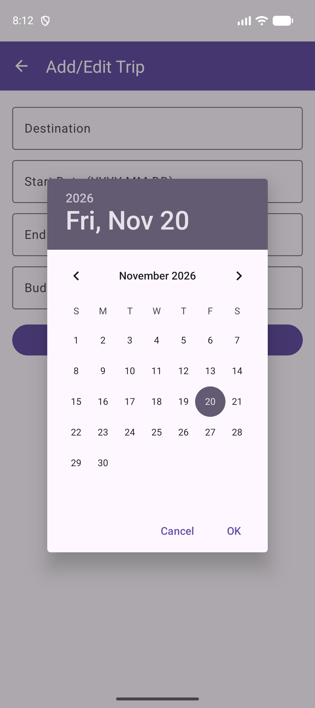
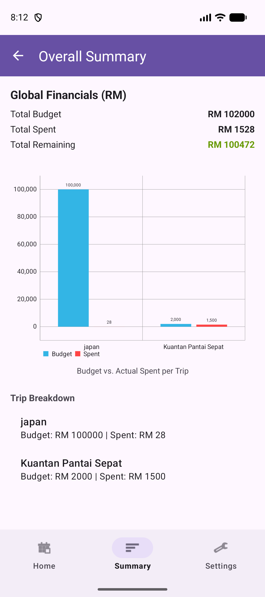

# Travel Expense Tracker

An Android mobile application for planning trips, logging multi-currency travel expenses, monitoring budgets in real time, and visualizing spending patterns through interactive charts.

## Screenshots

<table>
  <tr>
    <td align="center">
      <br />
      <sub><b>Main Dashboard</b></sub>
    </td>
    <td align="center">
      <br />
      <sub><b>Add Trip &amp; Date Picker</b></sub>
    </td>
    <td align="center">
      <br />
      <sub><b>Trip Details &amp; Expense History</b></sub>
    </td>
    <td align="center">
      <br />
      <sub><b>Log Multi-Currency Expense</b></sub>
    </td>
  </tr>
  <tr>
    <td align="center">
      <br />
      <sub><b>Trip Spending Summary</b></sub>
    </td>
    <td align="center">
      <br />
      <sub><b>Global Budget vs. Spending</b></sub>
    </td>
    <td align="center">
      <br />
      <sub><b>Settings</b></sub>
    </td>
    <td></td>
  </tr>
</table>

## Features

- **Trip Management**: Create, edit, search, and delete trips with destination details, travel dates, and budgets.
- **Expense Logging**: Record expenses per trip with amount validation, date, notes, category, and currency selection.
- **Multi-Currency Support**: Preloaded with 15 global currencies (`MYR`, `USD`, `EUR`, `GBP`, `SGD`, `JPY`, `KRW`, `AUD`, `CNY`, `THB`, `IDR`, `VND`, `INR`, `CAD`, `CHF`) with automatic conversion to the base currency (`MYR`) for budget tracking.
- **Real-Time Budget Tracking**: Displays total budget, amount spent, and remaining balance per trip, with visual indicators when spending exceeds budget.
- **Interactive Analytics**:
  - **Trip Spending Summary** (`SpendingSummaryActivity`): Visualizes per-trip spending breakdown by category using **MPAndroidChart**.
  - **Global Summary** (`GlobalSummaryActivity`): Aggregates financials across all trips with a comparative budget vs. actual spending bar chart.
- **Normalized Local Storage**: Built on a relational **SQLite** database (`trips`, `expenses`, `categories`, `currency`) with foreign-key constraints and cascading deletes.
- **Modern Android UI**: Material Design components, Edge-to-Edge layout support, Bottom Navigation, RecyclerViews, and Floating Action Buttons.

## Tech Stack

- **Language**: Java (Java 11 compatibility)
- **Platform**: Android (`minSdk 24`, `targetSdk 36`, `compileSdk 36`)
- **Build System**: Gradle (Kotlin DSL & Version Catalog)
- **UI**: AndroidX AppCompat, Material Components (`1.13.0`), ConstraintLayout
- **Database**: SQLite (`SQLiteOpenHelper`)
- **Data Visualization**: [MPAndroidChart](https://github.com/PhilJay/MPAndroidChart) (`v3.1.0`)

## Project Structure

```text
app/src/main/java/com/example/travelexpensetracker/
├── MainActivity.java              # Trip dashboard, search, and navigation
├── AddEditTripActivity.java       # Create and edit trip details
├── TripDetailsActivity.java       # Trip budget overview and expense list
├── AddExpenseActivity.java        # Log new expenses with category & currency
├── SpendingSummaryActivity.java   # Per-trip category spending chart
├── GlobalSummaryActivity.java     # Cross-trip budget vs. actual bar chart
├── SettingsActivity.java          # App preferences and database reset
├── adapter/
│   ├── TripAdapter.java           # RecyclerView adapter for trips
│   └── ExpenseAdapter.java        # RecyclerView adapter for expenses
├── database/
│   └── DatabaseHelper.java        # SQLite schema, seed data, and CRUD queries
└── model/
    ├── Trip.java
    ├── Expense.java
    ├── Category.java
    └── Currency.java
```

## Database Schema

The app uses a normalized SQLite database (`travel_tracker.db`, version 3):

- **`trips`**: `TripID` (PK), `Destination`, `StartDate`, `EndDate`, `Budget`
- **`categories`**: `CategoryID` (PK), `CategoryName` *(Accommodation, Food, Transport, Activities, Shopping)*
- **`currency`**: `CurrencyID` (PK), `CurrencyCode`, `ExchangeRate`
- **`expenses`**: `ExpenseID` (PK), `Amount`, `Date`, `Notes`, `TripID` (FK -> `trips`, `ON DELETE CASCADE`), `CategoryID` (FK -> `categories`), `CurrencyID` (FK -> `currency`)

## Getting Started

### Prerequisites

- Android Studio (latest stable release supporting AGP 9.x)
- JDK 11 or higher
- Android SDK 36 (with an emulator or physical device running Android 7.0 / API 24+)

### Build & Run

1. Clone the repository:
   ```bash
   git clone https://github.com/S1ngL3t0nZz/TravelExpenseTracker.git
   cd TravelExpenseTracker
   ```
2. Open the project in **Android Studio**.
3. Let Gradle sync dependencies (JitPack is used for `MPAndroidChart`).
4. Click **Run** (`Shift + F10`) to deploy to an emulator or connected Android device.

## Testing & Documentation

See [TESTING_AND_DEBUGGING.md](TESTING_AND_DEBUGGING.md) for documented test cases, edge-case validation, and resolved issues.
